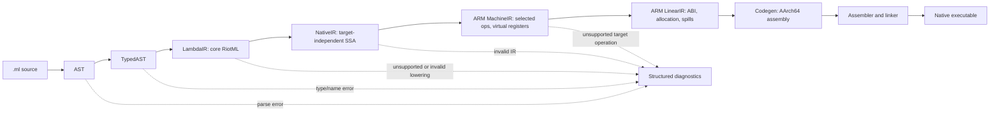

# RFD0051 - RiotML Owned Native Compiler Pipeline

- Feature Name: `riotml_owned_native_compiler_pipeline`
- Start Date: `2026-10-12`
- Status: `presented`
- RFD PR: `(not yet opened)`
- Riot Issue: `(not yet opened)`

## Summary
[summary]: #summary

This RFD proposes an owned native compiler pipeline for the TinyML-written
RiotML compiler: `.ml → AST → TypedAST → LambdaIR → NativeIR → ARM → Codegen`.
`LambdaIR` is the compiler's typed, desugared core language; `NativeIR` is a
target-independent SSA control-flow IR; the ARM backend lowers it through
machine and linear IRs before emitting AArch64 assembly. The compiler pipeline
and its IRs are to be implemented in the bootstrap-compatible TinyML/RiotML
source under `riotc/`, not as a Rust Stage 0 backend. Stage 0 remains
JavaScript-only and RFD0050's bootstrap acceptance
chain and language contracts remain unchanged. Until this proposal is accepted
and the new backend passes that chain, the existing C-plus-Clang backend
remains the working implementation and comparison path.

## Motivation
[motivation]: #motivation

RFD0050 proved that Stage 0 can compile the RiotML compiler to JavaScript, that
the JS-hosted compiler can produce a native compiler, and that the native
compiler can compile and run a program. The current native backend does this by
emitting C and invoking Clang. That route is useful bootstrap evidence, but
rebuilding the compiler through generated C and a general-purpose C compiler is
slow in observed use, and the backend does not yet give Riot ownership of the
machine-level representations or ARM code generation.

Riot ML is intended to own its language and compiler rather than permanently
rely on a host compiler's intermediate representation and code generator. A
clear chain of Riot-owned representations makes each lowering stage reviewable,
lets the typechecker hand proven facts to later passes, and gives the native
backend room to grow without mixing source semantics, runtime representation,
ARM instructions, and assembly syntax into one emitter. It also gives a future
compiler contributor a place to inspect where a source construct changes
meaning or representation.

The goal is not to imitate all of OCaml's optimizer or to claim that another
pipeline is automatically faster. It is to own a small, testable path from the
RiotML core to native code and measure it end to end. The current `riotc`
compiler already has a parser, name checking, rank-1 HM checking, module
loading, and a C backend. The proposal builds on those contracts while making
the backend boundary explicit.

## Goals

- Define and implement the compiler pipeline in RiotML source under `riotc/`.
- Keep parsing, type checking, language semantics, target-independent lowering,
  ARM lowering, and code emission as distinct reviewable stages.
- Make `LambdaIR` the typed, desugared core of supported RiotML semantics.
- Make `NativeIR` a target-independent SSA form with explicit control flow.
- Make ARM-specific selection, ABI/register handling, and code emission explicit
  stages rather than direct source-to-assembly translation.
- Preserve RFD0050's source-language, typechecking, host, and bootstrap
  acceptance contracts.
- Keep each IR printable and validated so failures can be localized to a pass.

## Non-goals

- Adding a native backend to the Rust Stage 0 TinyML compiler. Stage 0 continues
  to emit JavaScript for Node.
- Changing the RFD0050 bootstrap architecture or weakening its acceptance test.
- Redesigning RiotML syntax, rank-1 HM typing, modules, integers, strings, or
  the Host contract.
- Implementing actors, distribution, package management, Lean verification,
  an LSP, or a general-purpose optimization framework.
- Supporting every TinyML type in the first native backend; unsupported
  constructs must be rejected clearly rather than assigned a fallback
  representation.
- Writing a custom assembler, linker, object-file writer, or direct machine
  code encoder in the first slice.
- Selecting a final heap/GC design or changing runtime semantics in this RFD.

## Guide-level explanation
[guide-level-explanation]: #guide-level-explanation

A contributor should be able to follow one supported source program through
named representations. The parser produces syntax, the checker produces a
resolved and typed program, and lowering turns that program into a small
semantic core before the backend makes control flow and machine operations
explicit.

For example, the smoke program from RFD0050:

```ml
let main = fn () -> 42
```

first becomes an AST declaration, then a TypedAST declaration with the checked
entry type `unit -> i32`. LambdaIR represents the function and its return value
without ARM details. NativeIR gives the function a control-flow block and a
single SSA value for `42`. ARM lowering selects the return-value and return
instructions; Codegen emits assembly that the system assembler and linker turn
into the executable.



Each stage has a stable debug printer and a validator. During development, a
contributor can print or stop after any stage instead of debugging only the
final executable. No later stage silently repairs a type error or accepts a
malformed earlier IR.

The intended compiler path is:

```text
Rust Stage 0 TinyML compiler
        │ compiles the RiotML compiler source to JavaScript
        ▼
JavaScript-hosted RiotML compiler
        │ compiles that same source through the owned pipeline
        ▼
Native RiotML compiler
        │ can rebuild the same source and compile user programs
        ▼
AArch64 native executable
```

This does not move native code generation into Stage 0. It makes the
TinyML-written compiler's native path Riot-owned.

## Reference-level explanation
[reference-level-explanation]: #reference-level-explanation

### 1. Stage boundaries and responsibilities

#### 1.1 `.ml → AST`

The parser in `riotc/syntax/` remains responsible for lexical and syntactic
validity. AST nodes preserve source spans and describe syntax, not guessed
runtime representations. Parse failures become source diagnostics and stop the
pipeline.

**Why keep this stage:** syntax errors must be reported before typechecking,
and the source AST should remain useful for diagnostics and future tools even
when later IRs desugar syntax.

#### 1.2 `AST → TypedAST`

Name resolution and rank-1 HM checking establish the semantic facts used by
lowering. The TypedAST records resolved binding/entity identities, inferred or
annotated types, and source spans. Only an error-free checked module graph may
enter LambdaIR lowering. Checker diagnostics remain structured until the CLI
renders them.

**Why keep this stage:** the backend should consume trusted, resolved names and
types rather than repeat lookup or infer types from syntax. This also keeps an
invalid program from producing a plausible executable, as required by RFD0050.

The implementation may evolve the current `Check.Inference` API to return a
TypedAST; this RFD does not prescribe the concrete inference algorithm or
change the RFD0050 type-system contract.

#### 1.3 `TypedAST → LambdaIR`

LambdaIR is the typed, desugared, target-independent core RiotML language. It
removes source-only distinctions while preserving the semantics needed by the
backend. Its initial constructs should be the smallest complete semantic set
needed by `riotc` itself: values, recursive function declarations and
closures, direct and indirect calls, lets, primitive operations,
aggregates/constructors, and explicit matches or their equivalent core
control-flow form. It preserves source provenance for diagnostics.

LambdaIR does not encode ARM registers, stack slots, calling conventions,
object formats, or assembly text. Closure behavior must be specified here or at
its explicit lowering boundary; it must not be simulated by a placeholder
runtime call that discards captures or call arguments.

**Why keep this stage:** it gives Riot ML one canonical core semantics for
native lowering and future analyses. Source syntax can evolve without forcing
every backend pass to understand every surface form.

#### 1.4 `LambdaIR → NativeIR`

NativeIR is a target-independent SSA control-flow graph. Values have stable
IDs and exactly one definition; blocks have explicit parameters; branches,
switches, and returns are terminators. Joins pass values through block
parameters (the phi-equivalent form), not implicit mutable environments.

NativeIR operations preserve the exact checked source type needed for correct
lowering, including integer width and signedness. Calls, allocation, runtime
operations, and potentially trapping operations have explicit semantics or
effect classification. Aggregate layout and runtime calls are represented
symbolically; ARM registers and encodings are not.

Every NativeIR function is validated before target selection:

- the entry block exists and each block has one terminator;
- block and value IDs are unique and refer to existing definitions;
- definitions dominate their uses, including edge arguments;
- branch/switch edge arguments match destination block parameters in arity and
  type;
- return values match the declared result type;
- primitive operands and results satisfy the operation's exact type contract.

The verifier must reject malformed IR with a compiler diagnostic or internal
compiler error; it must not substitute zero, `Ptr`, or another guessed type.

**Why use SSA here:** values become explicit and immutable, which makes
control-flow merges, constant folding, liveness, and later register assignment
tractable. Keeping this IR target-independent allows new target backends without
repeating language-semantic lowering.

#### 1.5 `NativeIR → ARM MachineIR`

ARM MachineIR is target-specific instruction selection over virtual registers.
It defines the supported AArch64 operation set, condition codes, immediate
constraints, labels, call forms, and data operations. Target information
includes an explicit architecture/platform/ABI selection rather than assuming
that all ARM64 systems share one assembly or calling convention.

The first target is AArch64. The exact OS, object format, and ABI are still an
acceptance question. Instructions must distinguish integer widths and signed
operations where the source semantics require them. Unsupported NativeIR
operations produce diagnostics before assembly output is considered complete.

**Why split this stage from NativeIR:** target selection is where generic
operations become ISA-specific. It should not infect the typed language core
or prevent a later target from consuming NativeIR.

#### 1.6 `ARM MachineIR → ARM LinearIR`

ARM LinearIR makes execution order and machine resources explicit. This stage
lowers the selected virtual-register instructions according to the target ABI,
assigns physical registers, inserts spills and reloads, lays out stack slots and
frames, and resolves block control flow to an instruction sequence. Scheduling
and more advanced register allocation are optional optimizations, not
prerequisites for correctness.

**Why separate this stage:** instruction selection and physical resource
assignment have different invariants. A simple initial allocator can be
replaced without changing LambdaIR, NativeIR, or the instruction selector.

#### 1.7 `ARM LinearIR → Codegen`

Codegen emits AArch64 assembly for the declared platform and ABI. In the first
implementation, a configured system assembler and linker may produce the object
file and executable. This keeps instruction selection, register allocation,
frame layout, symbol conventions, and assembly emission Riot-owned without
requiring Riot to implement an assembler or linker.

The generated program may call explicitly declared runtime/Host helpers. Those
calls use a documented ABI; emitting C for each RiotML source module is not a
fallback for unsupported code. The existing C runtime may remain a support
library during migration if its ABI is explicitly represented and tested.

**Why this final boundary:** textual assembly is inspectable and can be tested
before execution. Delegating assembly/linking is a bounded toolchain dependency,
not a return to C as the source-language backend.

### 2. Shared invariants

All stages preserve these invariants:

1. **Source identity:** resolved names use binding/entity identity, not display
   names or sanitized assembly names. Backend symbols are uniquely mangled and
   collision-checked.
2. **Type fidelity:** each lowering preserves integer width, signedness,
   function/closure-call semantics, and nominal constructor identity needed for
   the supported subset. No stage silently coerces or defaults an unsupported
   representation.
3. **Evaluation behavior:** lowering preserves source evaluation order,
   short-circuit behavior where specified, observable effects, and trap
   behavior.
4. **Control-flow validity:** every block terminates; every edge transfers the
   correct arguments; matches retain all arms and failure behavior.
5. **ABI correctness:** calls, return values, stack alignment, callee-saved
   registers, symbols, and runtime helpers agree with the chosen target ABI.
6. **Artifact safety:** a failed parse, check, IR validation, target lowering,
   assembler, or link step returns failure and does not leave a plausible
   executable at the requested output path.
7. **Stage 0 boundary:** the Rust TinyML compiler remains JavaScript-only; all
   Riot-owned native IR lowering and code generation lives in the compiler
   source under `riotc/`.

### 3. Diagnostics and observability

Each stage returns either a valid next-stage value or diagnostics. Diagnostics
carry source spans whenever an error can be traced to user source; backend-only
failures identify the pass, function, target, and relevant IR location.

The compiler offers developer-facing stage dumps, for example:

```text
riotml compile source.ml --dump=ast
riotml compile source.ml --dump=typed-ast
riotml compile source.ml --dump=lambda
riotml compile source.ml --dump=native
riotml compile source.ml --dump=arm
```

Exact CLI syntax may follow the existing `riotc` CLI, but each dump format is
stable enough for tests and debugging. A verifier runs at IR boundaries in
tests and may be enabled in development builds. No debug dump is required for
normal successful compilation.

### 4. Runtime and compatibility boundary

This RFD owns the compiler representation pipeline, not a new source-language
runtime contract. The generated native code must preserve RFD0050's supported
program behavior and Host operations. Runtime value layout, closure layout,
allocation policy, and the first platform ABI must be made explicit before the
native backend can link arbitrary compiler code.

During bring-up, the existing C backend and runtime provide a behavioral
reference. The owned backend may call existing C runtime functions through an
explicit target ABI, but it must not use generated C as an implicit fallback
for source constructs. The C backend can be retired only after the end-to-end
acceptance criteria pass on a clean checkout and behavior agrees for the
supported corpus.

### 5. Validation and acceptance criteria

The pipeline is ready to replace the current C backend only when:

1. Unit tests exercise parsing/typechecking and each IR lowering, including
   positive and negative stage-verifier cases.
2. The native corpus covers every construct used by the compiler source and
   the RFD0050 smoke program; unsupported forms are rejected before codegen.
3. Differential tests compare the existing C backend and owned backend on
   shared fixtures until the C path is retired.
4. The Stage 0 compiler emits the RiotML compiler to JavaScript; running that
   compiler produces a native compiler through the owned pipeline.
5. That native compiler rebuilds the same compiler source into a successor
   native compiler, and the successor compiles a `main : unit -> i32` fixture
   whose executable exits with status 42.
6. Ill-typed input is rejected before codegen; assembler/linker failures return
   non-zero status and leave no plausible executable.
7. Formatting and `cargo test --workspace` pass; the documented acceptance
   sequence works from a clean checkout with no generated/untracked
   prerequisites.
8. Compile time and output size are measured against the C-plus-Clang baseline.
   This RFD sets no numeric performance target; a threshold must be agreed
   before performance is claimed as a release criterion.

The native self-rebuild criterion extends, rather than weakens, RFD0050's
existing JS-to-native and native-fixture acceptance chain.

## Drawbacks
[drawbacks]: #drawbacks

- Riot takes on more compiler implementation: typed IR construction, multiple
  lowerings, IR validation, instruction selection, ABI handling, register
  allocation, and assembly emission.
- More IR boundaries improve isolation but create design and maintenance costs;
  poorly specified IRs can become conversion boilerplate rather than useful
  semantic boundaries.
- A direct ARM backend is tied to an ABI and platform beyond the ISA. Supporting
  Apple arm64 and Linux/AAPCS64 may require separate assembly/object and runtime
  integration work.
- The existing C backend will need to remain temporarily for comparison,
  increasing maintenance until the owned path is validated and the C path is
  deliberately removed.
- An owned backend is not automatically faster. Naive lowering, all-spill
  code, poor ABI integration, or repeated passes could remain slow or produce
  larger binaries; profiling and agreed targets are required.
- Delegating final assembly/linking retains external assembler/linker
  dependencies, although it avoids implementing those large tools.

## Rationale and alternatives
[rationale-and-alternatives]: #rationale-and-alternatives

### Proposed design: owned stages with target-independent SSA

A typed, desugared LambdaIR separates RiotML semantics from machine details.
A target-independent SSA NativeIR provides explicit control flow and a stable
input to target backends. ARM MachineIR and LinearIR isolate instruction
selection from ABI/register allocation. Codegen then emits inspectable assembly.
This follows the useful separation found in OCaml's native pipeline without
copying its multiple optimizing middle ends or runtime.

### Keep C plus Clang as the permanent backend

This is the simplest near-term option and already passes the RFD0050 bootstrap
acceptance test. It should remain as the reference during implementation. It
was not selected as the permanent design because it leaves per-source code
generation and native semantics mediated by generated C and a C compiler,
rather than by Riot-owned IR and ARM lowering. The observed self-rebuild cost
also motivates measuring a direct backend, though it does not prove a direct
backend will be faster.

### Lower LambdaIR directly to ARM assembly

This uses fewer IRs and could produce a first executable sooner. It couples
language-semantic lowering, runtime representation, control-flow construction,
ABI details, and assembly syntax in one path. It also makes IR-level
optimization, validation, and future backends harder. It may be appropriate for
a deliberately throwaway spike, but not for the owned pipeline this RFD
proposes.

### Use an external IR/code generator (for example, LLVM)

An external backend could supply instruction selection, register allocation,
and object generation. It would reduce the amount of ARM machinery Riot must
write, but introduce a large external compiler dependency and a foreign IR/API
as the core backend contract. The request is to own this pipeline; adopting an
external code generator would need a separate RFD and explicit approval.

### Put ARM details directly into NativeIR

One target-specific SSA IR could remove a conversion stage. That makes every
NativeIR producer target-aware and makes future architectures either translate
from ARM concepts or duplicate the frontend. Keeping NativeIR target-independent
costs one lowering but establishes a cleaner extension point.

### Do nothing

The current C backend continues to provide the bootstrap path, but the compiler
remains dependent on C generation and Clang for every source-program build and
has no Riot-owned native IR/backend boundary. It remains useful as a baseline,
but does not deliver the pipeline described here.

## Prior art
[prior-art]: #prior-art

- [RFD0049 - Becoming a Language](RFD0049-becoming-a-language.md) makes Riot
  ML's parser, typed core, compiler, runtime semantics, diagnostics, and tooling
  Riot-owned concerns, while explicitly leaving the final core and backend
  architecture open. This RFD specifies one compiler-pipeline slice of that
  direction.
- [RFD0050 - TinyML Bootstrap Compiler](RFD0050-tinyml-bootstrap.md) defines
  the Stage 0 JavaScript host, source-language contract, and end-to-end
  self-compilation acceptance chain. This RFD preserves those requirements
  while proposing a future replacement for the C-plus-Clang source backend.
- The Rust Stage 0 experiment at commit
  [`892cf9459`](https://github.com/leostera/riot-lang/commit/892cf9459)
  sketched a block-parameter SSA program, a NativeIR-to-AArch64 selector, and
  textual assembly emission. It is useful design prior art, not code to restore
  to Stage 0: the RFD0050 trim intentionally removed that Rust backend. Its
  strongest reusable idea is the separation between generic SSA and target MIR;
  its incomplete match/control-flow, symbol identity, type-width, and register
  handling show why the new IR contracts need verifiers and end-to-end tests.
- OCaml 5.5.1's `driver/compile_common.ml` separates parsing and typechecking;
  `driver/optcompile.ml` lowers Typedtree through Lambda and a middle-end; and
  `asmcomp/asmgen.ml` lowers Clambda through Cmm, instruction selection,
  register allocation, Linear, emission, and the configured assembler. Its
  AArch64 modules separate instruction selection, procedure/ABI policy, and
  assembly emission. Riot should adopt the separation and observability, not
  OCaml's full optimization machinery. See [OCaml compiler source](https://github.com/ocaml/ocaml/tree/5.5.1/driver),
  [native backend](https://github.com/ocaml/ocaml/tree/5.5.1/asmcomp), and
  [AArch64 backend](https://github.com/ocaml/ocaml/tree/5.5.1/asmcomp/arm64).

## Decisions and remaining questions
[decisions-and-remaining-questions]: #decisions-and-remaining-questions

### Proposal recorded by this RFD

- The compiler implementation remains in TinyML/RiotML source under `riotc/`;
  the new pipeline is not implemented in Rust Stage 0.
- LambdaIR is the typed, desugared, target-independent core language.
- NativeIR is target-independent SSA with explicit basic blocks, terminators,
  and block arguments.
- ARM is split into target instruction selection, allocated/linear machine
  code, and code emission.
- Initial Codegen emits assembly and delegates object assembly/linking to
  configured platform tools; direct binary encoding is not required.
- C-plus-Clang remains the existing path and reference until the proposed path
  passes the acceptance criteria; this RFD does not itself claim the proposal
  has been accepted or implemented.
- RFD0050's Stage 0 architecture, language semantics, and completion bar remain
  unchanged. The additional native self-rebuild check is additive.

### Unresolved questions

- Which AArch64 platform and object ABI is the first supported target: Apple
  arm64, Linux AAPCS64, or both?
- Does the first ARM backend preserve the current tagged `RtValue` runtime
  representation, call selected C runtime helpers, or define a new runtime ABI
  in a separate proposal?
- What minimal set of optimization passes is needed after correctness and
  before performance measurement? Constant folding and DCE must respect exact
  fixed-width arithmetic and effect/trap behavior.
- What compile-time and output-size target makes the new compiler
  “reasonable”? No benchmark or numeric threshold is asserted here.
- What sequencing/cutover policy retires the current C backend after
  differential and bootstrap acceptance tests are reliable?

## Future possibilities
[future-possibilities]: #future-possibilities

Once the first owned ARM pipeline is correct, Riot may add additional target
backends that consume NativeIR, richer optimization passes, direct object-file
or machine-code emission, and target-specific debug information. Those are
future extensions, not prerequisites for accepting the stage boundaries in
this RFD. Changes to the runtime/GC model, actor lowering, or source-language
type contract require their own design review.
